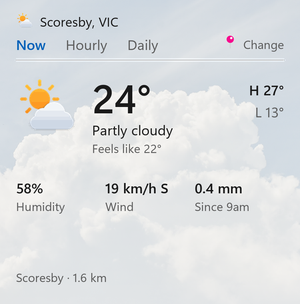
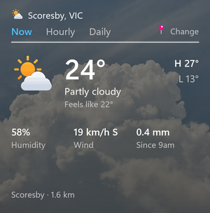

# Southerly

A Windows 11 weather widget for Australians that uses the Bureau of Meteorology's own forecasts and observations instead of MSN Weather. If you live near a BOM weather station, the temperature, wind and rain you see are that station's latest reading.

| Light | Dark |
| --- | --- |
|  |  |

## Features

- Small, Medium and Large layouts that each use their space properly. Medium has Now, Hourly and Daily tabs.
- Current conditions from the nearest BOM station, with the station name and distance.
- Five-day and hourly forecasts, today's rain chance and amount, UV with sun protection times, and fire danger when BOM rates your district.
- BOM warnings shown on the widget. Severe warnings also raise a Windows notification while the widget is running.
- Night icons and backgrounds, light and dark themes, and an offline state that keeps the last good data.
- Find your place by suburb, state or postcode (`Burwood NSW`, `2134`), or use your location. Tap the footer to open the full forecast on bom.gov.au.

## Requirements

- Windows 11 26H2 (build 26300) or later
- ARM64 by default; x64 is available (see below)
- .NET 10 SDK to build

## Build and run

From the `Southerly` folder:

```powershell
dotnet build                      # ARM64 (default)
dotnet build -p:Platform=x64      # x64
```

Close the widget host first so the files aren't locked, then register the build as a loose package:

```powershell
Stop-Process -Name WidgetBoard, WidgetService, Southerly -Force -ErrorAction SilentlyContinue
Add-AppxPackage -Register bin\ARM64\Debug\net10.0-windows10.0.28000.0\win-arm64\AppxManifest.xml
```

Open the Widgets board (Win + W), choose **+**, and add **Southerly Weather**. Raise the version in `Package.appxmanifest` whenever you change the manifest, or Windows refuses to re-register it.

## How it works

Windows runs `Southerly.exe` as a widget provider ([Windows App SDK widgets](https://learn.microsoft.com/windows/apps/develop/widgets/widget-providers)). It fetches BOM data and sends an [Adaptive Card](Southerly/Templates/WeatherWidgetTemplate.json) to the Widgets board. `$host.widgetSize` in the template picks the layout.

| File | What it does |
| --- | --- |
| `Southerly/WeatherWidget.cs` | One widget: location, tabs, BOM requests, notifications |
| `Southerly/WidgetProvider.cs` | COM entry points the Widgets host calls |
| `Southerly/Templates/WeatherWidgetTemplate.json` | The card for all three sizes |
| `tools/make_images.py` | Generates logos, picker images, weather icons and backgrounds |
| `tools/backgrounds/` | Source photos for `make_images.py` |

To change the icons or backgrounds, edit `tools/make_images.py` and run `python tools/make_images.py` (needs Pillow and Windows 11's Segoe UI Variable).

## About the data

Southerly calls the API behind the BOM weather website (`api.weather.bom.gov.au`). It is not a documented public API, can change without notice, and every response says it is owned by the Bureau and must not be used, copied or shared. Check the Bureau's [data services](https://www.bom.gov.au/resources/data-services) terms before distributing this beyond personal use.

## Licence

MIT. See [LICENSE](LICENSE). The widget provider scaffolding started from Microsoft's Windows widget sample.
